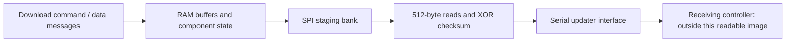

# R8 database-transfer path: static findings

This trace applies to BLES payload SHA-256
`651ac9987a5b7ee159a0b78dce60ce435c5051d5490106e57bb4f4c7ae6a37be`
(payload B in [R8 BLE analysis](R8_BLE_ANALYSIS.md)). It follows incoming
commands and data through RAM buffering, SPI staging and the serial updater
interface. No detector was connected and no firmware/data was sent to hardware.
It does not recover an AEUS key or establish that a new camera record alerts.

## Observed route and addresses



| Stage | Address in payload B | Static observation |
| --- | --- | --- |
| Message router | `0x07fc55e2` | Message kinds route command/data processing |
| Prefix classifier | `0x07fc6288` | Start=2, component stage=3, finish=4, flash-write=5 |
| Command dispatcher | `0x07fc6a28` | Model-dependent switch; the `0x90` branch has all six class entries |
| Start handler | `0x07fc6502` | Model check and session-state setup |
| Stage handler | `0x07fc680c` | `STR`/`END` and two-letter component labels; `GD` selects component 5 |
| Stage initializer | `0x07fc7cd0` | Component 5 binds its metadata and staging base `0x1a1000` |
| Binary-data handler | `0x07fc6a8e` | Routes accepted data into the active buffering operation |
| RAM-buffer copy | `0x07fc7c60` | Copies message payload into buffer slots and advances received count |
| SPI staging pump | `0x07fc7b4e` | Writes four 256-byte pieces of a 1024-byte buffered unit |
| Flash-program wrapper / primitive | `0x07fc1ba8` / `0x07fc1ac2` | Page bounds and SPI program command `0x02`; payload streaming via `0x07fc1790` |
| Finish handler | `0x07fc6908` | Closes/restores download state |
| Flash-write handler | `0x07fc695e` | Parses `R`/`N` flag, checks staged component metadata and hands off the write operation |
| Component transfer | `0x07fc8c36` | Component-5 branch uses the `FSW` serial updater path |
| Transfer descriptor | `0x07fc8888` | For a matching controller identifier, source=`0x1a1000`, page size=`0x200`, page count=`stored_length >> 9` |
| Staged-data read | `0x07fc1c36` | SPI command `0x03` and byte-copy into the transfer buffer |
| Checksum | `0x07fca892` | XOR of the input bytes; reads buffer without modifying it |
| Raw-byte send loop | `0x07fca3f6` | Sends each input byte through `0x07fca3e2` |
| Serial output helpers | `0x07fc1ffc` / `0x07fc2166` | Write peripheral data register and wait for transmit status |

The staging-base literal occurs at `0x07fc8030` and `0x07fc8f10`; both are
`0x1a1000`. The active buffer/state pointers used for data-to-code tracing are
`0x07fcd6f4` and `0x07fcdb68`. Their physical storage role and board wiring need
device corroboration; these are interpretations of the visible code.

The transfer worker reads a page into a local buffer, computes its XOR checksum,
passes that same buffer and length to the byte-send loop, then sends the checksum
and handles acknowledgement/retry. The checksum routine independently matches
the ARM byte-load/XOR loop. No application-level AES operation or key was found
in these traced copy/program/send routines. This is evidence about this path,
not a proof that every ROM or firmware component lacks cryptography.

The XOR value is a transport check, not the camera-record encoding. A completed
transfer does not show that the receiving controller decoded valid coordinates.
The receiver's internal database parsing/storage is outside this BLES image;
that controller's readable code or runtime observations are the next target.
An arbitrary-coordinate write interface has not been established.

## Compiler-generated switch tables: an explicit model

Without the ROM bytes, Ghidra initially treats calls to `0x07f1e154` as ordinary
calls and can decode their inline table bytes as bogus instructions. The callers
put the selector in r3. Their tables are consistent with Ghidra's existing
ARM `switch8_r3` / `__ARM_common_switch8` ABI:

- table begins immediately after the four-byte BL;
- first byte is the bounded case count;
- following bytes are halfword-scaled case/default displacements;
- target is `table_address + 2 * displacement`.

For example, the six-entry table at `0x07fc6a46` routes classes 1–5 to blocks
`0x07fc6a4e`, `0x07fc6a56`, `0x07fc6a5e`, `0x07fc6a66`, `0x07fc6a6e`.
The actual BL instructions in these blocks call the handlers in the table above.
Class 0 and the default route to `0x07fc6a76`.

`ModelR8RomSwitch.java` models this ABI without adding ROM bytes. It checks table
bounds and mapped case targets, marks only the inline tables immutable, adds
case-flow metadata and rebuilds bounded function bodies without absorbing other
functions. The ROM routine identity/ABI and runtime immutability of those tables
remain assumptions. They are consistent with the observed caller instructions
and table layouts; no ROM implementation or runtime trace was acquired.

The report records model assumptions, completion state and mapped-byte SHA-256.
The bytes still match the extracted input after all analysis annotations.
`RespectReadOnly` must be enabled in the decompiler for the modeled constant
tables to produce bounded switches. Otherwise plausible-looking output can
retain unresolved jumps and omit the interesting case bodies.

## Reproduce from a fresh import

First validate/extract your own matching BLES image as described in
[R8 BLE analysis](R8_BLE_ANALYSIS.md). Use Ghidra 12.1.4 with JDK 21:

```sh
mkdir -p /tmp/r8-ghidra-work
/path/to/ghidra/support/analyzeHeadless /tmp/r8-ghidra-work r8transfer \
  -import /tmp/r8-ble.bin \
  -loader BinaryLoader -loader-baseAddr 0x07fc0000 \
  -processor ARM:LE:32:Cortex -cspec default \
  -scriptPath "$PWD/ghidra_scripts" \
  -preScript SeedR8Ble.java \
  -postScript ModelR8RomSwitch.java 0x07f1e154 \
  -postScript R8BleReport.java /tmp/r8-ghidra-work/transfer.json \
    0x07fc6a28 0x07fc680c 0x07fc6908 0x07fc695e \
    0x07fc6a8e 0x07fc8c36 0x07fc7cd0 0x07fc869c \
    ptr:0x07fcd6f4 ptr:0x07fcdb68 0x07fc1ac2 0x07fc1790 \
  -analysisTimeoutPerFile 180 -deleteProject
```

Check the log for script errors, not just the process exit code: headless
processing can continue after a script failure. Require model completion and
`bytes_match_input_digest=true` in the JSON, and inspect each selected function's
decompiler status/warnings. This pipeline was reproduced from a fresh import;
the dispatcher, initializer, transfer worker and descriptor yielded bounded
switches, with unchanged payload bytes.

The optional explicit addresses can seed a previously undefined function, but
cannot split an existing function or select an unmapped entry. These seeds are
recorded as user input, not automatic proof of a function boundary. `ptr:`
queries find little-endian pointer occurrences and their references, including
RAM objects outside the mapped image. Reports contain local vendor pseudocode;
keep them and the extracted image outside version control.

## Remaining gap

To create new Hong Kong records, recover and verify the receiving controller's
database decoder/encoder or a supported record-write route. A candidate key must
reproduce complete official databases across independent releases before a new
point is built. A physical R8 test must then establish real GPS alerts. This
static transfer trace does not satisfy either of those requirements.
